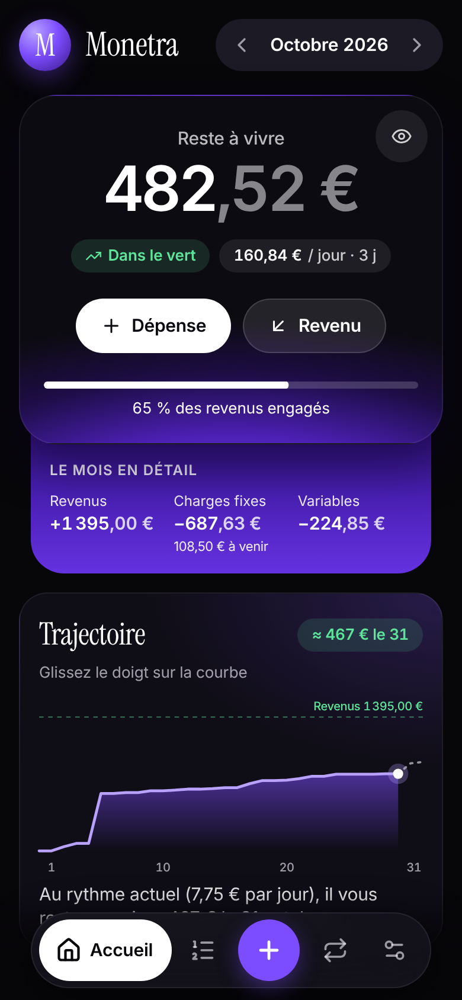
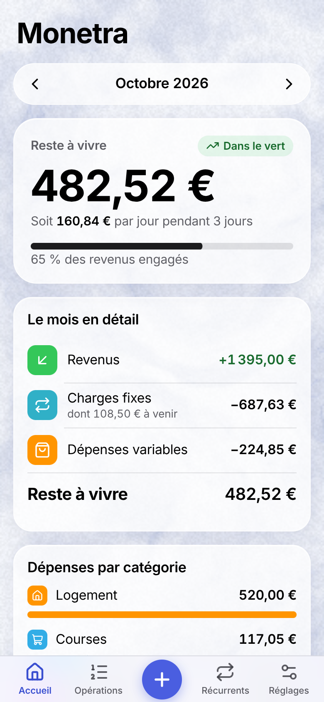
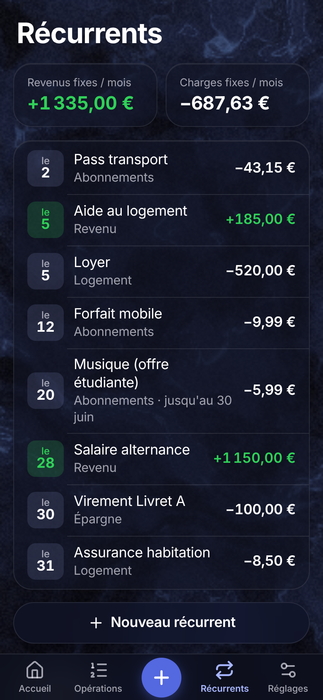
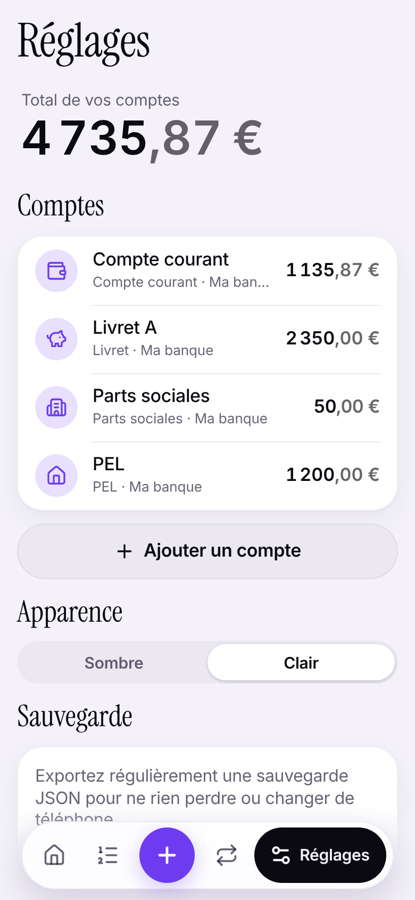
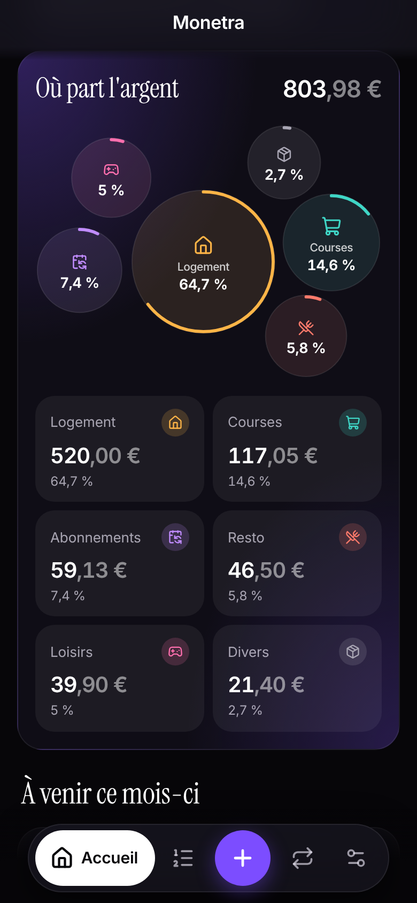
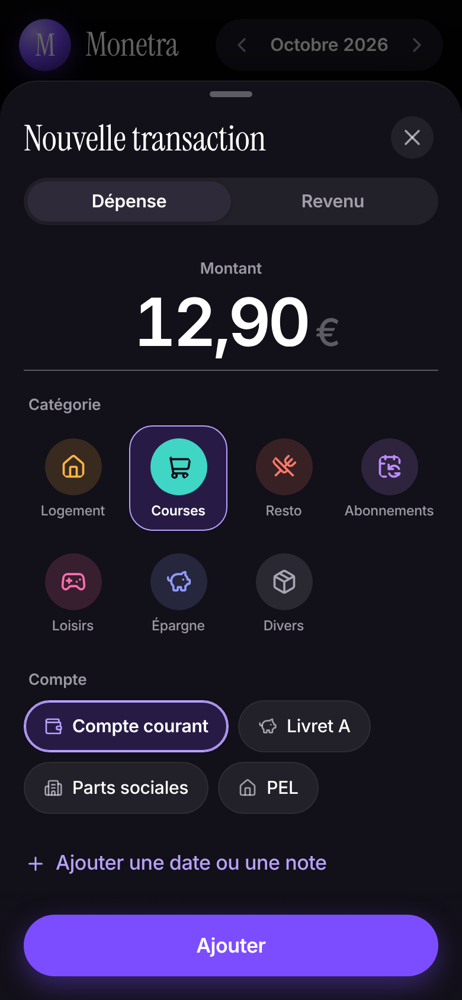
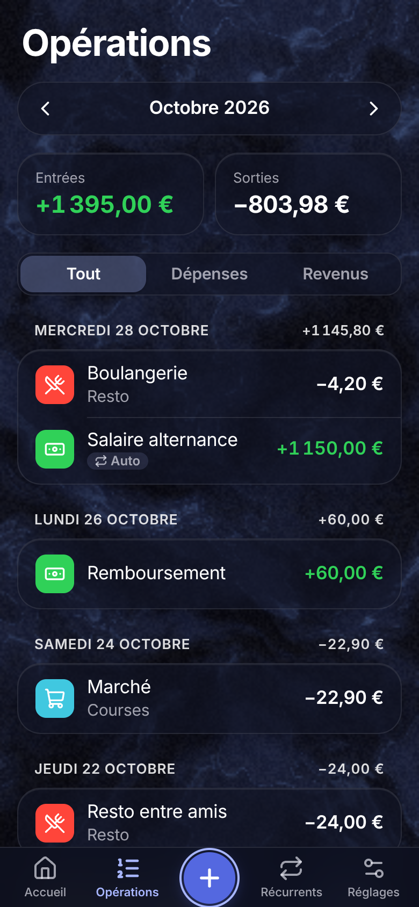
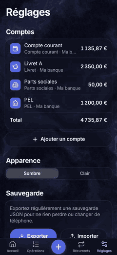
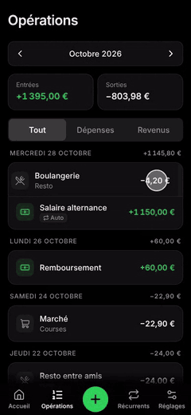
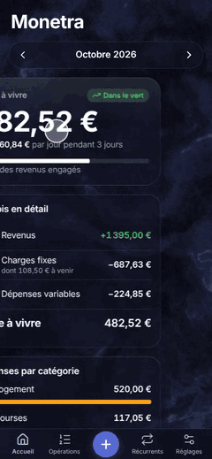

# Monetra

Monetra est une PWA de gestion de finances personnelles pensée pour un étudiant en alternance : suivre ses revenus, ses charges fixes et ses dépenses du mois, et voir d'un coup d'œil son **reste à vivre**.

- **100 % locale** : toutes les données restent dans le navigateur (IndexedDB). Rien n'est envoyé à un serveur.
- **Installable sur mobile** : PWA avec manifest, service worker et fonctionnement hors ligne.
- **Mobile-first** : saisie rapide d'une transaction en quelques taps.
- **Sauvegarde** : export / import JSON de toute la base.

## Fonctionnalités (V1)

- **Saisie rapide** : bouton `+` → montant → catégorie → Ajouter (3 taps).
- **Catégories** : logement, courses, resto/fast-food, abonnements, loisirs, épargne, divers.
- **Récurrents** : loyer, forfait, salaire… générés automatiquement chaque mois au jour indiqué, avec date de fin optionnelle.
- **Tableau de bord du mois** : revenus, charges fixes, dépenses variables et reste à vivre (occurrences à venir incluses).
- **Opérations du mois** : liste par jour, édition et suppression.
- **Comptes** : courant, livret, PEL, PER, assurance-vie, parts sociales ; le solde suit les transactions.
- **Export / import JSON** de toute la base.
- **Réflexes iOS** : appui long sur une opération pour Modifier / Dupliquer / Supprimer, retours haptiques (iPhone compris), toucher l'onglet actif pour remonter, toast qu'on balaie, thème Automatique.

Aucune donnée n'est écrite en dur : tout se saisit depuis l'app.

   

## Design

L'interface suit le design system [`design-system/monetra/MASTER.md`](design-system/monetra/MASTER.md) : **noir et violet, graphique**, dans l'esprit d'une app bancaire moderne.

- **Fond noir uni**, un seul accent violet ; vert réservé aux revenus, rouge aux erreurs.
- **Reste à vivre** dans un panneau noir qui s'embrase en violet, avec un plateau glissé dessous (revenus, charges, variables) et des actions rapides « Dépense » / « Revenu ».
- **Où part l'argent** : bulles par catégorie (taille = poids, arc = part du total), doublées de tuiles chiffrées.
- **Registre** : sur Opérations et Récurrents, un résumé chiffré puis une grande surface qui porte la liste, groupée par jour.
- **Capsule d'onglets flottante** : onglet actif en pastille avec libellé, bouton d'ajout violet au centre.
- **Titres en serif éditoriale** (Instrument Serif), interface en SF Pro sous Safari et Inter ailleurs, auto-hébergées ; montants en chiffres tabulaires, **centimes estompés**.
- Icônes SVG Lucide dans des pastilles rondes teintées, sans emojis. Thème clair dans Réglages (les panneaux graphiques restent sombres).

   

### Mouvement

Les règles viennent des skills d'[Emil Kowalski](https://github.com/emilkowalski/skills) (`emil-design-eng`, `gestures`, `mobile-native`…) et du skill `apple-design`, installés dans `.agents/skills/`.

- **Le mouvement se mérite** : l'écran ne s'anime pas au changement d'onglet, seule la pastille glisse ; les retours à l'appui durent 140 ms ; les transitions restent courtes et sans rebond.
- **Retour à l'appui, pas au relâcher**, en CSS (`:active`).
- **Sheet glissable** : suivi 1:1, rubber-band vers le haut, fermeture décidée par la vélocité et la projection du momentum, voile qui suit le geste, rattrapable en pleine fermeture.
- **Swipe pour supprimer** (opérations, récurrents) avec seuil, rubber-band et annulation depuis un toast.
- **Swipe horizontal** sur l'accueil pour changer de mois, avec snap et momentum.
- Reste à vivre qui glisse en spring vers sa nouvelle valeur.
- Respect de `prefers-reduced-motion`, `prefers-reduced-transparency` et `prefers-contrast`.

  

Vidéos des gestes : [`docs/videos/`](docs/videos).

## Stack

- [Vite](https://vite.dev/) + [React](https://react.dev/) + TypeScript
- [vite-plugin-pwa](https://vite-pwa-org.netlify.app/) : manifest, service worker, offline
- [Dexie.js](https://dexie.org/) : stockage IndexedDB
- [Motion](https://motion.dev/) : springs, gestes, `layoutId` / `layout` et animations SVG (le reste du mouvement est en CSS) ; [Motion AI Kit](https://motion.dev/docs/ai-kit) installé pour les agents (skill `motion` et agent `motion-reviewer` dans `.claude/`, serveurs MCP dans `.mcp.json`)
- [Lucide](https://lucide.dev/) : icônes SVG ; police système (SF Pro), [Inter](https://rsms.me/inter/) auto-hébergée en repli, [Instrument Serif](https://fonts.google.com/specimen/Instrument+Serif) pour les titres
- [Playwright](https://playwright.dev/) : tests e2e tactiles

## Lancer en local

Prérequis : Node.js 20+ et npm.

```bash
npm install
npm run dev
```

L'app est servie sur http://localhost:5173.

Autres commandes :

```bash
npm run build     # build de production dans dist/
npm run preview   # sert le build (service worker actif)
npm run lint      # lint avec oxlint
npm test          # tests unitaires (Vitest)
npm run test:e2e  # tests e2e Playwright en émulation iPhone (build + preview automatiques)
npm run record:videos  # enregistre les vidéos des gestes (test-results/)
```

## Déploiement

L'app est publiée sur GitHub Pages à chaque push sur `main` : **https://tibolecodeur.github.io/Monetra/**. Le workflow est `.github/workflows/deploy.yml` (lint, tests unitaires, build, publication).

- Une seule fois : **Settings → Pages → Source : GitHub Actions**.
- Le build de production est servi dans le sous-dossier `/Monetra/`, via la variable `BASE_PATH` ; en local, tout reste à la racine.
- Pour l'installer sur iPhone : ouvrez l'URL dans Safari, puis **Partager → Sur l'écran d'accueil**.

Pour tester l'installation sur mobile, servez le build (`npm run preview -- --host`) et ouvrez l'URL depuis le téléphone sur le même réseau. L'installation de la PWA demande HTTPS, sauf sur `localhost`.
