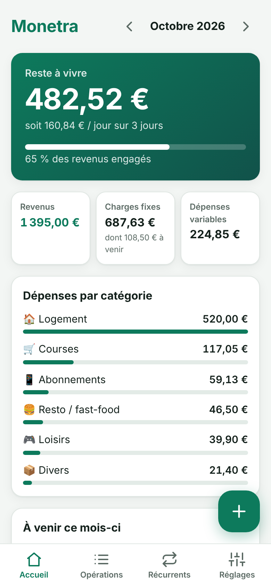

# Monetra

Monetra est une PWA de gestion de finances personnelles pensée pour un étudiant en alternance : suivre ses revenus, ses charges fixes et ses dépenses du mois, et voir d'un coup d'œil son **reste à vivre**.

- **100 % locale** : toutes les données restent dans le navigateur (IndexedDB). Rien n'est envoyé à un serveur.
- **Installable sur mobile** : PWA avec manifest, service worker et fonctionnement hors ligne.
- **Mobile-first** : saisie rapide d'une transaction en quelques taps.
- **Sauvegarde** : export / import JSON de toute la base.

## Fonctionnalités (V1)

- **Saisie rapide** : bouton `+` → montant → catégorie → Ajouter (3 taps).
- **Catégories** : logement, courses, resto/fast-food, abonnements, loisirs, épargne, divers.
- **Récurrents** : loyer, forfait, salaire… générés automatiquement chaque mois au jour indiqué, avec date de fin optionnelle.
- **Tableau de bord du mois** : revenus, charges fixes, dépenses variables et reste à vivre (occurrences à venir incluses).
- **Opérations du mois** : liste par jour, édition et suppression.
- **Comptes** : courant, livret, PEL, PER, assurance-vie, parts sociales ; le solde suit les transactions.
- **Export / import JSON** de toute la base.

Aucune donnée n'est écrite en dur : tout se saisit depuis l'app.



## Stack

- [Vite](https://vite.dev/) + [React](https://react.dev/) + TypeScript
- [vite-plugin-pwa](https://vite-pwa-org.netlify.app/) : manifest, service worker, offline
- [Dexie.js](https://dexie.org/) : stockage IndexedDB

## Lancer en local

Prérequis : Node.js 20+ et npm.

```bash
npm install
npm run dev
```

L'app est servie sur http://localhost:5173.

Autres commandes :

```bash
npm run build     # build de production dans dist/
npm run preview   # sert le build (service worker actif)
npm run lint      # lint avec oxlint
npm test          # tests unitaires (Vitest)
```

Pour tester l'installation sur mobile, servez le build (`npm run preview -- --host`) et ouvrez l'URL depuis le téléphone sur le même réseau. L'installation de la PWA demande HTTPS, sauf sur `localhost`.
