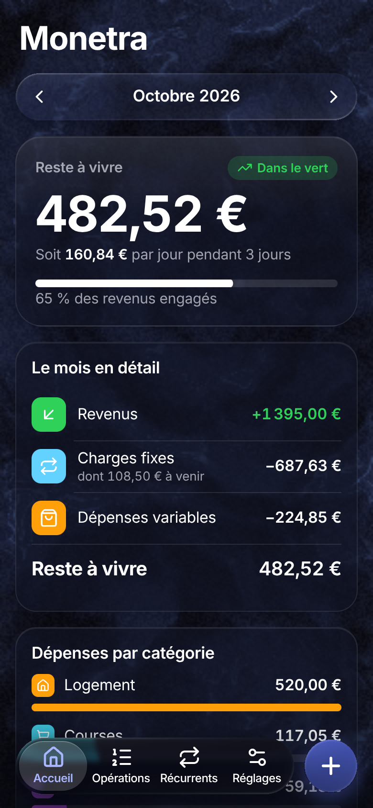
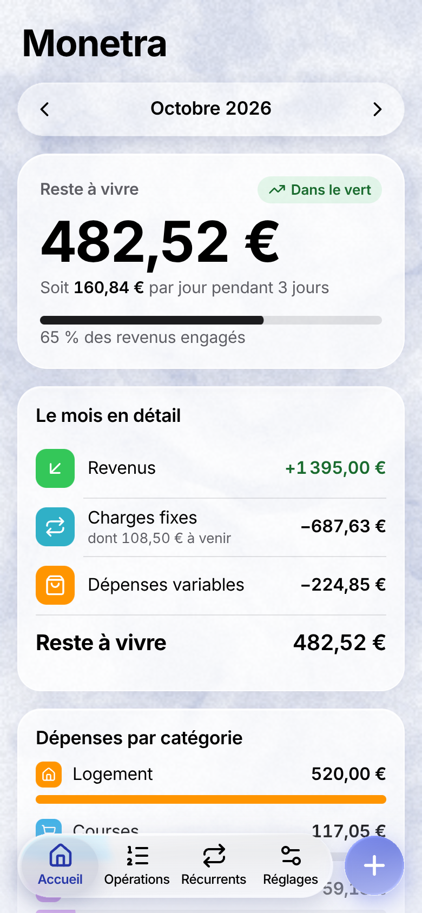
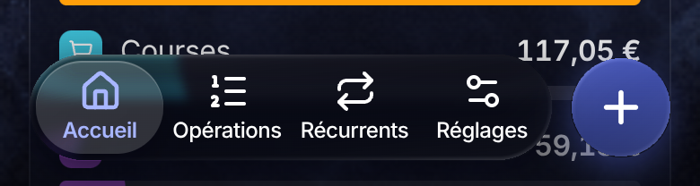
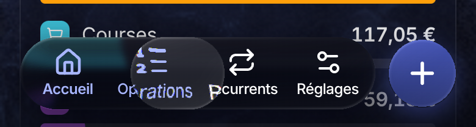

# Monetra

Monetra est une PWA de gestion de finances personnelles pensée pour un étudiant en alternance : suivre ses revenus, ses charges fixes et ses dépenses du mois, et voir d'un coup d'œil son **reste à vivre**.

- **100 % locale** : toutes les données restent dans le navigateur (IndexedDB). Rien n'est envoyé à un serveur.
- **Installable sur mobile** : PWA avec manifest, service worker et fonctionnement hors ligne.
- **Mobile-first** : saisie rapide d'une transaction en quelques taps.
- **Sauvegarde** : export / import JSON de toute la base.

## Fonctionnalités (V1)

- **Saisie rapide** : bouton `+` → montant → catégorie → Ajouter (3 taps).
- **Catégories** : logement, courses, resto/fast-food, abonnements, loisirs, épargne, divers.
- **Récurrents** : loyer, forfait, salaire… générés automatiquement chaque mois au jour indiqué, avec date de fin optionnelle.
- **Tableau de bord du mois** : revenus, charges fixes, dépenses variables et reste à vivre (occurrences à venir incluses).
- **Opérations du mois** : liste par jour, édition et suppression.
- **Comptes** : courant, livret, PEL, PER, assurance-vie, parts sociales ; le solde suit les transactions.
- **Export / import JSON** de toute la base.

Aucune donnée n'est écrite en dur : tout se saisit depuis l'app.

   

## Design

L'interface suit le design system [`design-system/monetra/MASTER.md`](design-system/monetra/MASTER.md), généré avec le skill UI UX Pro Max puis révisé :

- **Liquid Glass sur fond plasma** : navigation et contrôles en verre qui réfracte vraiment le contenu qui passe dessous (biseau, frange chromatique, reflet, ombre), identique sur Safari, iPhone, Chrome et Firefox ; contenu sur des cartes dépolies, grand titre repliable avec scroll edge effect. Sombre par défaut, clair dans Réglages.
- **Lentilles de sélection** : la bulle de l'onglet actif et le curseur du contrôle segmenté grossissent les libellés qu'ils traversent, et se font glisser au doigt comme sur iOS 26.

 
- **Palette tirée du fond** : accent pervenche, vert pour les revenus, pastilles de catégorie colorées façon iOS.
- **Inter** pour toute l'interface, auto-hébergée (aucune requête externe) ; montants en chiffres tabulaires.
- Icônes SVG Lucide, sans emojis.
- Pensé pour une main : barre d'onglets en bas avec le bouton d'ajout au centre, zones tactiles de 44 px minimum.

### Interactions fluides

Les principes du skill `apple-design` (`.claude/skills/apple-design/SKILL.md`), avec la librairie [Motion](https://motion.dev/) :

- **Springs** paramétrés comme chez Apple (damping ratio + response), interruptibles, qui reprennent la vélocité du doigt.
- **Sheet glissable** : suivi 1:1, rubber-band vers le haut, fermeture décidée par la vélocité et la projection du momentum, voile qui suit le geste.
- **Swipe pour supprimer** (opérations, récurrents) avec seuil, rubber-band et annulation depuis un toast.
- **Swipe horizontal** sur l'accueil pour changer de mois, avec snap et momentum.
- **Retour visuel au pointer-down** partout ; reste à vivre animé en spring.
- **Verre interactif** : il gonfle et s'éclaire sous le doigt, puis rebondit ; la lumière rayonne vers le verre voisin du dock.
- **Bulle de la tab bar glissable** : doigt posé, elle se soulève ; on la fait glisser d'un onglet à l'autre (rubber-band, momentum, étirement selon la vitesse). Même chose pour le curseur du contrôle segmenté.
- **Tab bar réduite au défilement** (comme `tabBarMinimizeBehavior(.onScrollDown)`), rouverte en remontant ou au toucher.
- **Sheets en verre flottant**, décollées des bords, et boutons principaux en « glass prominent ».
- Règles tirées du skill [`liquid-glass`](https://github.com/haider-nawaz/liquid-glass-skill) (SwiftUI), copié dans `.claude/skills/liquid-glass/`.
- **Tab bar** en Liquid Glass, avec scroll edge effect.
- Respect de `prefers-reduced-motion`, `prefers-reduced-transparency` et `prefers-contrast`.

Vidéos des gestes : [`docs/videos/`](docs/videos).

## Stack

- [Vite](https://vite.dev/) + [React](https://react.dev/) + TypeScript
- [vite-plugin-pwa](https://vite-pwa-org.netlify.app/) : manifest, service worker, offline
- [Dexie.js](https://dexie.org/) : stockage IndexedDB
- [Motion](https://motion.dev/) : springs et gestes
- Fond animé [`@componentry/closing-plasma`](https://componentry.dev) (WebGL), installé via `shadcn`
- Liquid Glass (`src/lib/glass/`) : technique de [liquid-glass-web-react](https://github.com/PallavAg/liquid-glass-web-react) (MIT), étendue à une scène à plusieurs lentilles. Le filtre SVG est posé sur le contenu et non en `backdrop-filter`, ce qui le rend compatible Safari. L'app défile donc dans un conteneur (`.scroller`) et non dans la fenêtre.
- [Lucide](https://lucide.dev/) : icônes SVG ; police système (SF Pro), [Inter](https://rsms.me/inter/) auto-hébergée en repli
- [Playwright](https://playwright.dev/) : tests e2e tactiles

## Lancer en local

Prérequis : Node.js 20+ et npm.

```bash
npm install
npm run dev
```

L'app est servie sur http://localhost:5173.

Autres commandes :

```bash
npm run build     # build de production dans dist/
npm run preview   # sert le build (service worker actif)
npm run lint      # lint avec oxlint
npm test          # tests unitaires (Vitest)
npm run test:e2e  # tests e2e Playwright en émulation iPhone (build + preview automatiques)
npm run record:videos  # enregistre les vidéos des gestes (test-results/)
```

## Déploiement

L'app est publiée sur GitHub Pages à chaque push sur `main` : **https://tibolecodeur.github.io/Monetra/**. Le workflow est `.github/workflows/deploy.yml` (lint, tests unitaires, build, publication).

- Une seule fois : **Settings → Pages → Source : GitHub Actions**.
- Le build de production est servi dans le sous-dossier `/Monetra/`, via la variable `BASE_PATH` ; en local, tout reste à la racine.
- Pour l'installer sur iPhone : ouvrez l'URL dans Safari, puis **Partager → Sur l'écran d'accueil**.

Pour tester l'installation sur mobile, servez le build (`npm run preview -- --host`) et ouvrez l'URL depuis le téléphone sur le même réseau. L'installation de la PWA demande HTTPS, sauf sur `localhost`.
