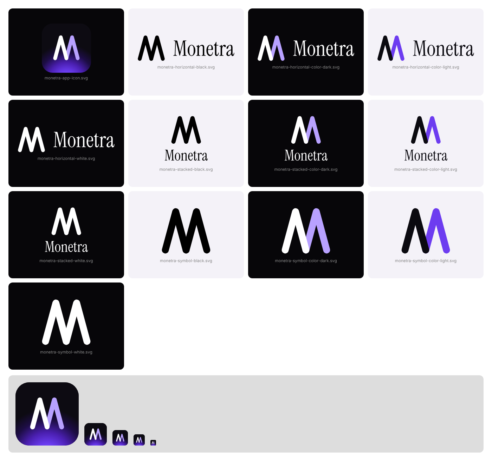

# Monetra : logo « Moitiés »

## 1. L'idée

Un M en deux pics égaux, l'un clair, l'autre violet. Ce qui entre, ce qui sort : le M n'existe que si les deux moitiés tiennent ensemble. C'est l'équilibre que l'app aide à garder chaque mois.

## 2. Les fichiers

| Version | Fichiers | Quand |
|---|---|---|
| Symbole | `monetra-symbol-*.svg` | Icône, avatar, petits formats, tout ce qui est carré |
| Horizontal | `monetra-horizontal-*.svg` | Version principale : en-têtes, documents, site |
| Empilé | `monetra-stacked-*.svg` | Formats étroits ou centrés (écran d'accueil, affiche) |
| Icône d'app | `monetra-app-icon.svg` = `public/favicon.svg` | Favicon et icône PWA (tuile noire, lueur violette) |

Chaque version existe en quatre déclinaisons :

- `color-dark` : blanc + violet `#B8A1FF`, sur fond sombre ;
- `color-light` : encre + violet `#6D3CF0`, sur fond clair ;
- `black` : une seule couleur, noir ;
- `white` : une seule couleur, blanc (inversé).

Les PNG de la PWA se régénèrent depuis `public/logo-full.svg` avec `npm run icons`. On ne les retouche jamais à la main.

## 3. Construction

- Grille de 256 : deux Λ identiques (sommets à x = 86 et 170, y = 50), bases à y = 206 ; les deux moitiés partagent le point bas (x = 128).
- Un seul trait de **28** (≈ 11 % de la largeur), bouts et angles arrondis.
- La moitié gauche (claire ou encre) passe **devant** la droite au point bas.
- Le mot « Monetra » est en Instrument Serif 400, vectorisé (aucune police à charger). Dans le logo horizontal, sa hauteur de capitale vaut 0,6 × la hauteur du symbole, et il est centré verticalement sur lui.

## 4. Zone de protection

Autour du logo, on laisse vide **2 × l'épaisseur du trait** (2 × 28 sur la grille de 256, soit environ 22 % de la largeur du symbole). La zone grandit et rétrécit avec le logo.

## 5. Tailles minimales

| Version | Écran |
|---|---|
| Symbole seul | 16 px (favicon) ; 24 px conseillé ailleurs |
| Horizontal | 96 px de large |
| Empilé | 64 px de large |

## 6. Couleurs

| Nom | HEX | Rôle |
|---|---|---|
| Blanc | `#FFFFFF` | Moitié gauche sur fond sombre |
| Violet clair | `#B8A1FF` | Moitié droite sur fond sombre (`--color-accent-text`) |
| Encre | `#0B0A10` | Moitié gauche et mot sur fond clair |
| Violet | `#6D3CF0` | Moitié droite sur fond clair (`--color-accent` clair) |
| Noir de l'icône | `#0D0B12` | Tuile de l'icône, sous la lueur violette |

**Fonds autorisés :**

- la version `color-dark` sur le noir de l'app ou sur la tuile à lueur violette ;
- la version `color-light` sur `#F4F2F8` ou sur du blanc ;
- les versions `black` et `white` partout où une seule couleur est imposée (impression, broderie, tampon).

## 7. À éviter

- Inverser les couleurs des moitiés (le violet est toujours à droite).
- Mettre les deux moitiés dans deux violets différents.
- Déformer, pencher ou faire tourner le M, ou écarter les deux pics.
- Ajouter une ombre, un contour, un dégradé dans le trait ou un effet.
- Retaper « Monetra » dans une police : on utilise les fichiers vectorisés.
- Poser le logo sur une photo chargée sans la tuile noire.

## 8. Origine

Ce logo a été conçu avec le skill [`logo-design`](https://github.com/kaankiziltug/logo-design-skill) (mode refonte). Il remplace le « M. » en Instrument Serif du 13 novembre 2026. L'équilibre comme idée et le M comme base ont été choisis au troisième tour de pistes.

Un logo n'est jamais protégé par défaut : avant tout dépôt de marque, il faut faire une recherche d'antériorité (bases INPI/EUIPO, recherche d'image inversée).
